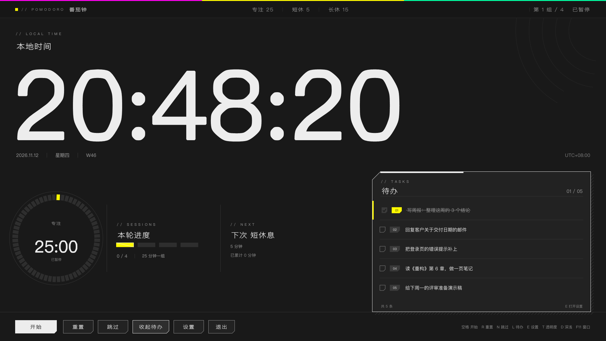

# 桌面时钟番茄钟

桌面时钟 + 番茄钟 + 待办清单，Windows 和 macOS 两版。

| 平台 | 版本 | 实现 | 怎么装 |
|---|---|---|---|
| Windows | **2.0.0** | Win32 + GDI+，单文件 260 KB，界面重做成控制台风格 | [下载 exe](https://github.com/juhao138/pomodoro-clock/releases/latest) |
| **macOS** | **2.0.0** | Swift + AppKit + Core Graphics 原生应用，通用二进制 | [下载 dmg](https://github.com/juhao138/pomodoro-clock/releases/latest) |


## macOS 版 1.0

同一套番茄钟 / 待办 / 设置，用 Swift + AppKit 重写成原生应用——不套 Electron、不用 WebView，
窗口、圆盘、切角、命中区域全部自绘。界面按「终末地风味」重制：纸面、一个强调色、切角表示可按、细线分区。

| 浅色 | 深色 |
|---|---|
|  |  |

- **安装** — 从 [Releases](https://github.com/juhao138/pomodoro-clock/releases/latest) 下载 `pomodoro-clock-v2.0.0-macos.dmg`，双击挂载，把「桌面番茄钟」拖进「应用程序」；也可以 `cd macos && ./package.sh` 自己打一个
- **通用二进制** — x86_64 + arm64，Intel 与 Apple Silicon 都能跑，要求 macOS 12 以上
- **和 Windows 版一致** — 番茄钟状态机（含超时结转、每 4 个专注进长休）、`todo.txt` 格式、命令行参数、`--selftest`
- **macOS 版多出来的** — 深色主题、↑↓ 选待办、滚轮翻页、跟随系统「减弱动态效果」
- 完整说明见 [macos/README.md](macos/README.md)

## 功能（Windows 版）

- **时钟是主角** — 横贯整个窗口的宽体数字，每秒刷新
- **番茄钟** — 专注 25 / 短休 5 / 长休 15，每 4 个专注自动进长休，阶段自动衔接，超时时间结转到下一阶段
- **分段圆盘** — 60 格刻度环显示进度，当前那一格是黄色；环内是剩余时间和阶段
- **本轮进度与下一次** — 4 段进度块、已完成次数、下次是短休还是长休
- **待办看板** — 定时浮出（默认每 30 秒露 8 秒），按 L 常驻；点勾选框切换完成，滚轮翻页
- **一个设置窗口** — 待办清单 + 背景图片都在里面，按 E 打开
- **浅色 / 深色两套主题** — 按 D 切换，选择记在 settings.ini
- **柔和提示音** — 程序内合成的风铃音（E5-G5-C6 琶音），不依赖音频文件

## 截图（Windows 版）

| 浅色 | 深色 |
|---|---|
|  |  |

## 快速开始（Windows）

双击 `桌面时钟番茄钟.exe`，Esc 退出。

### 底部按钮

```
[ 开始/暂停 ]  [ 重置 ]  [ 跳过 ]  [ 待办 ]  [ 设置 ]  [ 退出 ]
```

「待办」按下立刻收起看板，「设置」打开设置窗口；点圆盘也能开始 / 暂停。

### 键盘

| 键 | 作用 | 备用键 |
|---|---|---|
| 空格 | 开始 / 暂停（点进度环也行） | |
| R | 重置回专注 25:00 | F4 |
| N | 跳过当前阶段 | F5 |
| L | 待办常驻 / 收起（也可以点看板底部的「常驻」） | F3 |
| E | 打开设置窗口 | F2 |
| T | 透明度循环（100% / 91% / 78% / 66%） | F6 |
| D | 浅色 / 深色 | F7 |
| ↑ ↓ | 选择待办条目 | |
| F11 | 全屏 ↔ 窗口（980×640） | |
| Esc | 退出 | |

> 中文输入法下字母键会被当成拼音吃掉，所以主窗口用 `ImmAssociateContext(hwnd, NULL)`
> 摘掉了 IME 关联；万一你的输入法还是抢先，用 F2–F6 这套等价键位。

### 命令行

```
桌面时钟番茄钟.exe --work 50 --short 10 --long 30     # 自定义时长（分钟）
桌面时钟番茄钟.exe --list-every 30 --list-dur 8        # 待办浮出节奏
桌面时钟番茄钟.exe --breath-period 18                  # 背景明暗周期（秒）
桌面时钟番茄钟.exe --todo-file D:\list.txt             # 指定清单文件
桌面时钟番茄钟.exe --bg-image D:\wallpaper.jpg         # 指定背景图
桌面时钟番茄钟.exe --window                            # 窗口模式启动
桌面时钟番茄钟.exe --opacity 2                         # 启动时的透明度档位
桌面时钟番茄钟.exe --mute                              # 不响提示音
桌面时钟番茄钟.exe --test-chime                        # 试听提示音
桌面时钟番茄钟.exe --font-check                        # 打印实际使用的字体
桌面时钟番茄钟.exe --theme dark                         # 深色主题启动
桌面时钟番茄钟.exe --render out.png --size 1920x1080   # 把界面渲染成 PNG（版式自检）
桌面时钟番茄钟.exe --selftest                          # 跑 26 项自测，不开窗口
```

### 配置文件

设置存在 exe 同目录的 `settings.ini`：

```ini
bg_image=D:\wallpaper.jpg
```

待办清单存在 exe 同目录的 `todo.txt`（不可写时退到 `%APPDATA%\PomodoroClock`），
格式是 `完成标记<TAB>内容`：

```
0	写周报：整理这周的 3 个结论
1	回复客户的邮件
```

## 自己编译（Windows）

只需要 [Zig](https://ziglang.org/download/)（单文件编译器，免安装）：

```bat
python _build\make_clock_icon.py                       :: 生成 _build\clock.ico
python _build\make_res.py _build\clock.ico _build\clock.res

zig cc -target x86_64-windows-gnu -O2 -std=c11 ^
       -Wl,--subsystem,windows -Wl,-e,mainCRTStartup ^
       -o 桌面时钟番茄钟.exe pomodoro_clock.c _build\clock.res ^
       -lgdiplus -lgdi32 -luser32 -lole32 -lcomctl32 -limm32 -lwinmm -lmsimg32 -lcomdlg32
```

`_build\make_res.py` 把 `.ico` 打包成 Windows 资源（RT_ICON + RT_GROUP_ICON），
不需要 windres / llvm-rc。

## 实现要点

- **一套自绘**：纸面、细线、切角、刻度环、编号标签全部用 GDI+ 画，没有贴图、没有第三方控件
- **字体**：拉丁用 Bahnschrift（Windows 10+ 自带的可变字体），中文用微软雅黑；GDI+ 只能拿到默认字重，
  所以大字用「路径 + 描边」补出粗体
- **切角**：一个 `cut_path()` 生成五边形，可填可描边；切角只出现在「可按」的东西上
- **圆盘**：60 段圆弧，已过墨色、当前黄色、未到浅灰，每帧按剩余比例重算
- **双缓冲**：画到 32 位 DIB Section 再 `BitBlt`，全屏不闪
- **计时不漂移**：16ms 定时器触发，但用 `GetTickCount64` 算真实 dt；跨过阶段终点时多余时间结转到下一阶段
- **按需重绘**：只在秒数变化、淡入淡出、悬停变化时刷屏，静止时几乎不耗 CPU
- **离屏自检**：`--render` 不建窗口直接渲染 PNG，改版式时不用开程序

## 目录

```
pomodoro_clock.c            全部源码（约 3000 行，单文件）
_build/make_clock_icon.py   用 Pillow 画图标（墨底 + 12 格刻度环）
_build/make_res.py          把 .ico 打包成 .res 资源
docs/使用说明.txt            面向使用者的中文说明
docs/screenshots/           截图（Windows）
docs/screenshots-macos/     截图（macOS）
macos/                      macOS 版源码与说明（./build.sh 编译，./package.sh 打 dmg）
```

## 已知限制

- 只覆盖主显示器
- 全屏是普通置顶窗口，不阻止系统休眠
- 设置窗口用的是系统 LISTBOX / EDIT，只是换了配色和按钮外观，不是全自绘
- 清单上限 128 条，单条 160 字
- 背景图压到 12% 垫在纸面下，不再做明暗呼吸

## 贡献者

本项目由人和 AI 协作完成，详见 [CONTRIBUTORS.md](CONTRIBUTORS.md)。

| 贡献者 | 角色 |
|---|---|
| [@juhao138](https://github.com/juhao138) | 需求、设计方向、实机验证与反复打磨 |
| **DeepSeek** | 代码实现、调试、自测用例 |

## License

MIT
