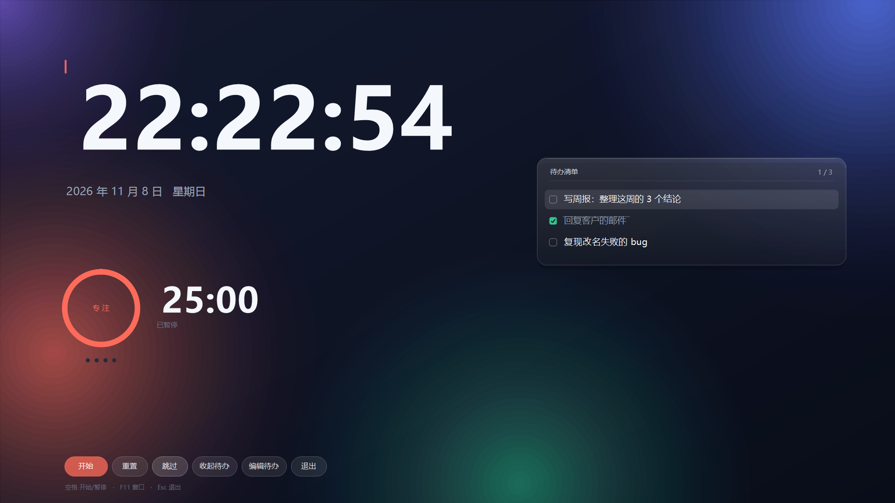
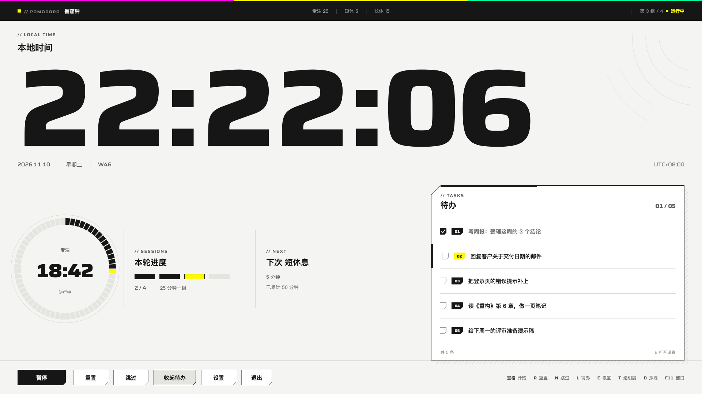
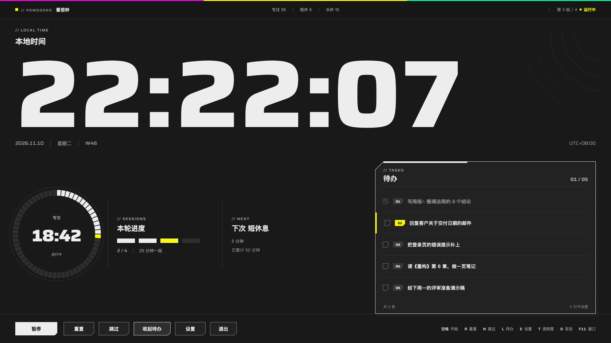
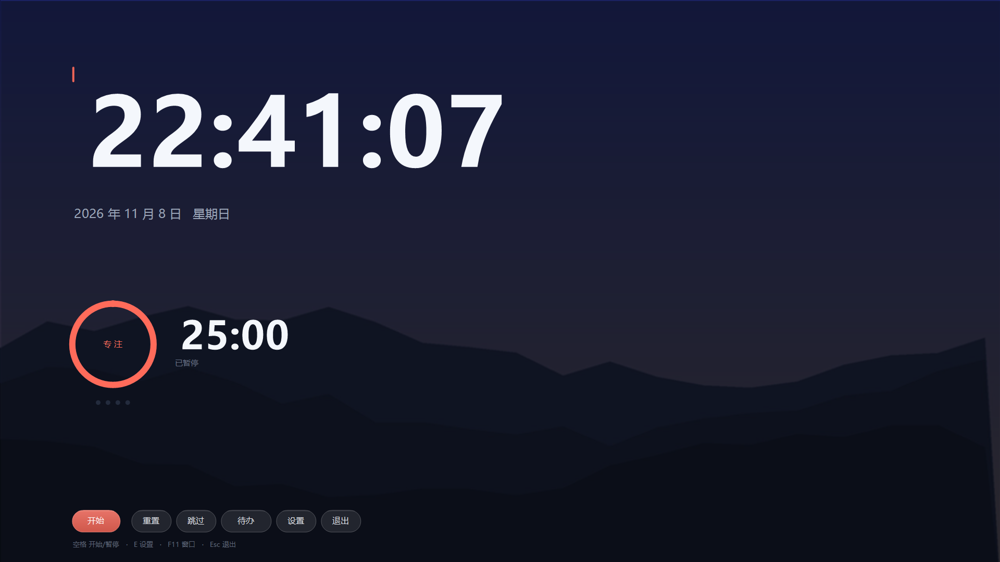
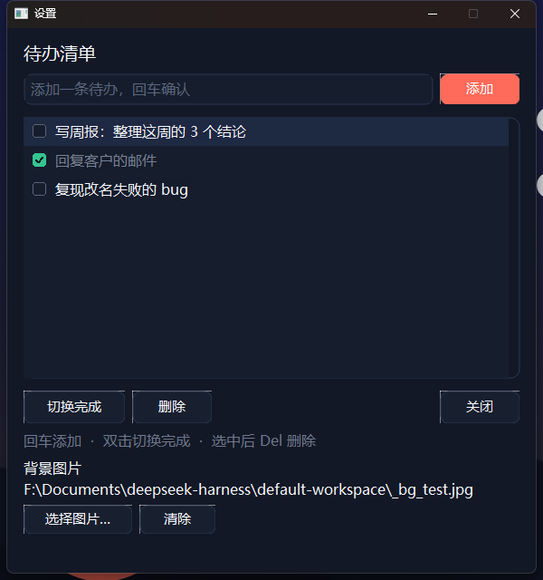

# 桌面时钟番茄钟

桌面时钟 + 番茄钟 + 待办清单，两个平台：

| 平台 | 实现 | 位置 |
|---|---|---|
| Windows | Win32 + GDI+，单文件 300 KB，不依赖任何运行库 | 本目录 |
| macOS | Swift + AppKit + Core Graphics 原生应用，界面按终末地风格重制 | [macos/](macos/README.md) |



> **macOS 版**（Swift，无 Electron）：同一套番茄钟 / 待办 / 设置，界面重画成「纸面 + 一个强调色 + 切角」的控制台。
>
> | 浅色 | 深色 |
> |---|---|
> |  |  |
>
> 使用说明见 [macos/README.md](macos/README.md)。

## 功能

- **时钟是主角** — 雅黑粗体超大字号，每秒刷新，左侧对齐，一眼看清几点
- **番茄钟** — 专注 25 / 短休 5 / 长休 15，每 4 个专注自动进长休，阶段自动衔接
- **待办清单** — 毛玻璃卡片，定时浮出（默认每 30 秒露 8 秒），也可以按 L 常驻
- **可点的按钮** — 底部一排药丸按钮，悬停变亮、按下下沉、鼠标变手型
- **一个设置窗口** — 待办清单 + 背景图片都在里面，按 E 打开，随时关掉不影响主画面
- **自定义背景图** — 选一张图等比铺满，自动压暗保证文字可读，选择会记住
- **动态明暗** — 极光 / 背景图以 18 秒为周期缓慢呼吸，静止画面也不死板
- **柔和提示音** — 程序内合成的风铃音（E5-G5-C6 琶音），不依赖音频文件
- **低占用** — 前台 CPU 约 4%，内存 32 MB；窗口不在前台时自动降到约 2fps

## 截图

| 默认渐变背景 | 自定义背景图 |
|---|---|
|  |  |

**设置窗口**（待办清单 + 背景图片）



## 快速开始（Windows）

双击 `桌面时钟番茄钟.exe`，Esc 退出。

### 底部按钮

```
[ 开始/暂停 ]  [ 重置 ]  [ 跳过 ]  [ 待办 ]  [ 设置 ]  [ 退出 ]
```

「待办」按下立刻收起卡片，「设置」打开设置窗口。

### 键盘

| 键 | 作用 | 备用键 |
|---|---|---|
| 空格 | 开始 / 暂停（点进度环也行） | |
| R | 重置回专注 25:00 | F4 |
| N | 跳过当前阶段 | F5 |
| L | 待办常驻 / 收起 | F3 |
| E | 打开设置窗口 | F2 |
| T | 透明度循环（100% / 91% / 78% / 66%） | F6 |
| ↑ ↓ | 选择待办条目 | |
| F11 | 全屏 ↔ 窗口（980×640） | |
| Esc | 退出 | |

> 中文输入法下字母键会被当成拼音吃掉，所以主窗口用 `ImmAssociateContext(hwnd, NULL)`
> 摘掉了 IME 关联；万一你的输入法还是抢先，用 F2–F6 这套等价键位。

### 命令行

```
桌面时钟番茄钟.exe --work 50 --short 10 --long 30     # 自定义时长（分钟）
桌面时钟番茄钟.exe --list-every 30 --list-dur 8        # 待办浮出节奏
桌面时钟番茄钟.exe --breath-period 18                  # 背景明暗周期（秒）
桌面时钟番茄钟.exe --todo-file D:\list.txt             # 指定清单文件
桌面时钟番茄钟.exe --bg-image D:\wallpaper.jpg         # 指定背景图
桌面时钟番茄钟.exe --window                            # 窗口模式启动
桌面时钟番茄钟.exe --opacity 2                         # 启动时的透明度档位
桌面时钟番茄钟.exe --mute                              # 不响提示音
桌面时钟番茄钟.exe --test-chime                        # 试听提示音
桌面时钟番茄钟.exe --font-check                        # 打印实际使用的字体
桌面时钟番茄钟.exe --selftest                          # 跑 26 项自测，不开窗口
```

### 配置文件

设置存在 exe 同目录的 `settings.ini`：

```ini
bg_image=D:\wallpaper.jpg
```

待办清单存在 exe 同目录的 `todo.txt`（不可写时退到 `%APPDATA%\PomodoroClock`），
格式是 `完成标记<TAB>内容`：

```
0	写周报：整理这周的 3 个结论
1	回复客户的邮件
```

## 自己编译（Windows）

只需要 [Zig](https://ziglang.org/download/)（单文件编译器，免安装）：

```bat
python _build\make_clock_icon.py                       :: 生成 _build\clock.ico
python _build\make_res.py _build\clock.ico _build\clock.res

zig cc -O2 -std=c11 -Wl,--subsystem,windows -Wl,-e,mainCRTStartup ^
       -o 桌面时钟番茄钟.exe pomodoro_clock.c _build\clock.res ^
       -lgdiplus -lgdi32 -luser32 -lole32 -lcomctl32 -limm32 -lwinmm -lmsimg32 -lcomdlg32
```

`_build\make_res.py` 把 `.ico` 打包成 Windows 资源（RT_ICON + RT_GROUP_ICON），
不需要 windres / llvm-rc。

## 实现要点

- **Win32 + GDI+**：圆角、弧线、文本全部抗锯齿；小字用 ClearType 并对齐整像素，
  大字用灰度抗锯齿（避免彩色毛边）
- **双缓冲**：画到 32 位 DIB Section 再 `BitBlt`，全屏不闪
- **背景呼吸**：预渲染「暗相 / 亮相」两张背景，逐帧按正弦 `AlphaBlend` 交叉淡入，
  呼吸的是极光本身而不是盖一层灰
- **半分辨率合成**：背景按 1/2 分辨率渲染、合成，再拉伸到全屏 —— 渐变和光晕本来就平滑，
  肉眼无差，但合成开销降到 1/4（CPU 9.9% → 4.4%，内存 49 → 32 MB）
- **时钟位图缓存**：184px 的大字缓存成 ARGB 位图，每秒重建一次，其余帧直接贴
- **毛玻璃卡片**：圆角裁剪 + 白色竖向渐变（12%→4%）+ 1px 描边 + 顶部高光 + 淡投影
- **计时不漂移**：定时器 16ms 触发，但用 `GetTickCount64` 算真实 dt；
  一次 tick 跨过阶段终点时，多余时间结转到下一阶段
- **按需重绘**：只在淡入淡出、秒数变化、呼吸档位变化时刷屏
- **分层窗口按需启用**：只有透明度 <100% 时才挂 `WS_EX_LAYERED`
  （分层窗口会让系统禁用 ClearType，小字会发虚）

## 目录

```
pomodoro_clock.c            全部源码（约 2400 行，单文件）
_build/make_clock_icon.py   用 Pillow 画图标
_build/make_res.py          把 .ico 打包成 .res 资源
docs/使用说明.txt            面向使用者的中文说明
docs/screenshots/           截图（Windows）
docs/screenshots-macos/     截图（macOS）
macos/                      macOS 版源码与说明
```

## 已知限制

- 只覆盖主显示器
- 全屏是普通置顶窗口，不阻止系统休眠
- 设置窗口用系统 LISTBOX（条目自绘），滚动条是自绘的
- 清单上限 128 条，单条 160 字
- 背景图没有高斯模糊（GDI+ 无现成模糊，自己卷积代价太大）

## 贡献者

本项目由人和 AI 协作完成，详见 [CONTRIBUTORS.md](CONTRIBUTORS.md)。

| 贡献者 | 角色 |
|---|---|
| [@juhao138](https://github.com/juhao138) | 需求、设计方向、实机验证与反复打磨 |
| **DeepSeek** | 代码实现、调试、自测用例 |

## License

MIT
