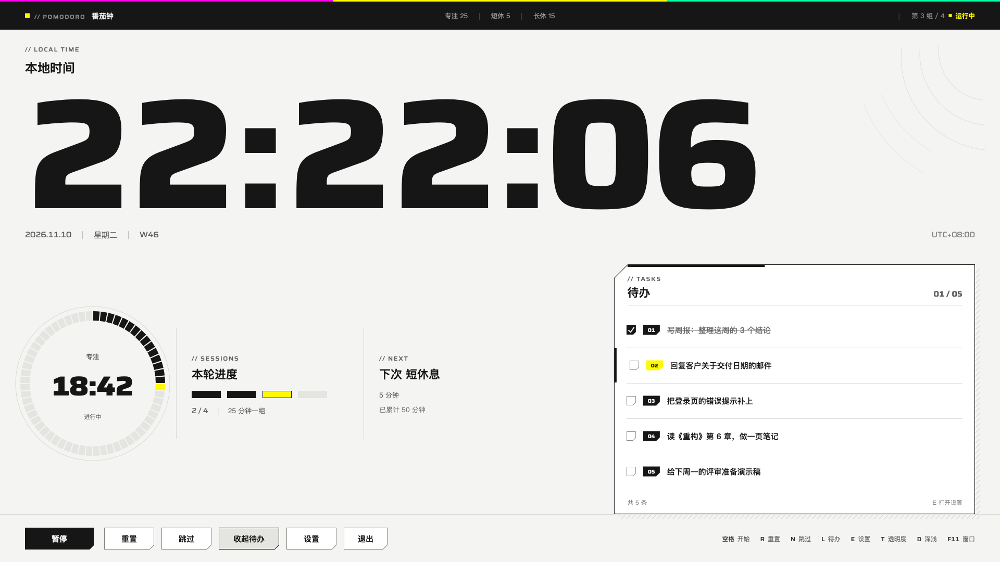

# 桌面番茄钟 · macOS 版 2.0

> 版本 2.0 · 通用二进制（x86_64 + arm64）· 要求 macOS 12 以上

Windows 版是 Win32 + GDI+ 的单文件程序。macOS 没有这两样东西，所以这一版重写为
**Swift + AppKit + Core Graphics 的原生应用**：窗口、文字、圆盘、切角、命中区域全部自绘，
不依赖第三方库，没有 Electron / WebView。

界面按「终末地风味」重做了一遍：纸面 + 一个强调色 + 切角表示可按 + 细线分区 + 宽体拉丁字。



---

## 变体卡

```text
变体：标准（yellow / neutral / standard / contours / standard / calm）
主视觉：横贯整幅的等宽时钟，下面一台仪表盘：60 格分段圆盘 + 本轮进度 + 待办看板
页面类型：控制台（设置面板按阅读页收紧）
```

- 强调色只有一种：`#FFFA00`。只出现在「当前 / 可按 / 提醒」三处：品牌小方块、当前那一格进度、当前那行待办的编号、悬停擦入、以及圆盘上指示当前刻度的那一格。
- 切角 = 可以按：按钮、编号标签、勾选框、设置面板的芯片。正文和看板里的内容都是直角。
- 圆角一律为 0，没有投影、发光、渐变；看板右下角那层影子是硬边的 45° 斜线纹。
- 红色只给「删除」。

## 功能

和 Windows 版一致的功能：

- **时钟是主角** — 等宽宽体数字，横贯整个窗口，每秒刷新
- **番茄钟** — 专注 25 / 短休 5 / 长休 15，每 4 个专注自动进长休，阶段自动衔接，超时时间结转到下一阶段
- **待办清单** — 定时浮出（默认每 30 秒露 8 秒），按 L 常驻；点勾选框切换完成，点行选中
- **设置面板** — 待办增删改、背景图片、深浅外观、提示音开关，按 E 打开
- **自定义背景图** — 选一张图等比铺满，压到 12% 不透明度垫在纸面下，不破坏文字对比度
- **柔和提示音** — 程序内合成的风铃音（E5-G5-C6 琶音），不依赖音频文件
- **命令行参数、`--selftest`、配置文件** — 与 Windows 版同名同义

macOS 版新加的：

- **深色主题** — 另一套完整配色（不是反色），按 D 切换，选择会记住
- **键盘选择待办** — ↑↓ 移动，自动常驻并滚动到可见位置
- **滚轮翻页** — 待办多于可见行时用滚轮翻
- **减少动态效果** — 系统打开「减弱动态效果」后，所有渐入、擦入、面板进出立即到位

## 运行

从 [Releases](https://github.com/juhao138/pomodoro-clock/releases/latest) 下载 `pomodoro-clock-v2.0.0-macos.dmg`，
双击挂载后把「桌面番茄钟」拖进「应用程序」即可。自己编译的话：

```bash
open dist/桌面番茄钟.app          # 或双击
```

启动即是覆盖主显示器的全屏窗口，Esc 退出。

### 按键

| 键 | 作用 |
|---|---|
| 空格 | 开始 / 暂停（点圆盘也行） |
| R | 重置回专注 25:00 |
| N | 跳过当前阶段 |
| L | 待办常驻 / 收起 |
| E | 打开设置 |
| T | 透明度循环（100% / 91% / 78% / 66%） |
| D | 浅色 / 深色 |
| ↑ ↓ | 选择待办条目 |
| F11 | 全屏 ↔ 窗口（1120×720） |
| Esc | 退出（设置打开时先关面板） |

### 命令行

```bash
桌面番茄钟.app/Contents/MacOS/PomodoroClock --work 50 --short 10 --long 30
桌面番茄钟.app/Contents/MacOS/PomodoroClock --list-every 30 --list-dur 8
桌面番茄钟.app/Contents/MacOS/PomodoroClock --todo-file ~/list.txt
桌面番茄钟.app/Contents/MacOS/PomodoroClock --data-dir ~/Dropbox/pomodoro   # 便携模式
桌面番茄钟.app/Contents/MacOS/PomodoroClock --window            # 窗口模式启动
桌面番茄钟.app/Contents/MacOS/PomodoroClock --theme dark
桌面番茄钟.app/Contents/MacOS/PomodoroClock --mute
桌面番茄钟.app/Contents/MacOS/PomodoroClock --test-chime        # 试听提示音
桌面番茄钟.app/Contents/MacOS/PomodoroClock --selftest          # 26 项逻辑自测
桌面番茄钟.app/Contents/MacOS/PomodoroClock --uicheck           # 点击区域自测
桌面番茄钟.app/Contents/MacOS/PomodoroClock --snapshot out.png --demo --size 1920x1080
```

`--snapshot` 会把界面离屏渲染成 PNG 后退出，改版式时不用开着窗口截图。

### 文件位置

```
~/Library/Application Support/PomodoroClock/todo.txt       待办清单，格式：完成标记<TAB>内容
~/Library/Application Support/PomodoroClock/settings.json  外观、透明度、提示音、背景图

用 `--data-dir` 可以把这两个文件放到任意目录（便携模式）。
```

## 自己编译

只需要 Xcode 命令行工具（`xcode-select --install`），不需要 Xcode 工程：

```bash
cd macos
./build.sh        # 编译通用二进制（x86_64 + arm64）+ 组装 dist/桌面番茄钟.app + 本地签名
./package.sh      # 再打一个 dist/桌面番茄钟-2.0.dmg（内含「应用程序」替身）
```

产物：

```
dist/桌面番茄钟.app          双击即可运行
dist/桌面番茄钟-2.0.dmg      拷到别的机器，拖进「应用程序」安装
```

图标由 `macos/scripts/make_icon.py` 生成（需要 Pillow），产物 `macos/Resources/AppIcon.icns` 已经提交，
平时改界面不需要重跑。

## 源码结构

```
macos/Sources/Theme.swift          配色、两套主题、动效曲线
macos/Sources/Text.swift           Saira 可变字体（宽度轴 112/125、等宽数字）+ 苹方，文字绘制
macos/Sources/Paint.swift          切角、细线、斜线纹、等高线、按钮、编号标签、勾选框
macos/Sources/Model.swift          番茄钟状态机、待办存储、配置、提示音合成
macos/Sources/Home.swift           主屏版式与绘制、点击命中
macos/Sources/SettingsPanel.swift  设置面板版式与绘制
macos/Sources/App.swift            窗口、事件、计时循环、菜单
macos/Sources/main.swift           命令行、自测、离线渲染、入口
macos/Resources/Saira.ttf          Saira 可变字体（SIL OFL 1.1，许可证随附）
```

绘制是「版式函数 + 立即绘制」：`homeLayout(size:scene:)` 算出全部矩形，`drawHome` 照着画，
`homeHitTest` 用同一份版式做命中，所以按钮画在哪、能不能点，永远一致。

## 和 Windows 版的差异

| | Windows | macOS |
|---|---|---|
| 绘制 | GDI+ 双缓冲 DIB | Core Graphics 直接画进 NSView |
| 全屏 | `WS_POPUP` + 置顶 | 无边框窗口覆盖屏幕，普通层级（不抢别的窗口） |
| 待办浮出 | 右下角毛玻璃卡片淡入淡出 | 右侧看板整体换入，行按 55ms 错开落位 |
| 外观 | 深色单套 | 浅色 / 深色两套 |
| 背景呼吸 | 极光 18 秒正弦明暗 | 去掉（持续循环的装饰动画和这套风格冲突） |
| 配置 | `settings.ini`（exe 同目录） | `~/Library/Application Support/PomodoroClock/settings.json` |
| 输入法 | `ImmAssociateContext(NULL)` 摘掉 IME | 主窗口不吃文字输入，本来就没有 IME 问题 |

`--breath-period` 仍然接受参数，但不再有呼吸效果。

## 许可

代码 MIT。`Resources/Saira.ttf` 是 Saira 字体（SIL Open Font License 1.1），许可证见
`Resources/Saira-OFL.txt`。界面里没有使用任何游戏官方素材。
